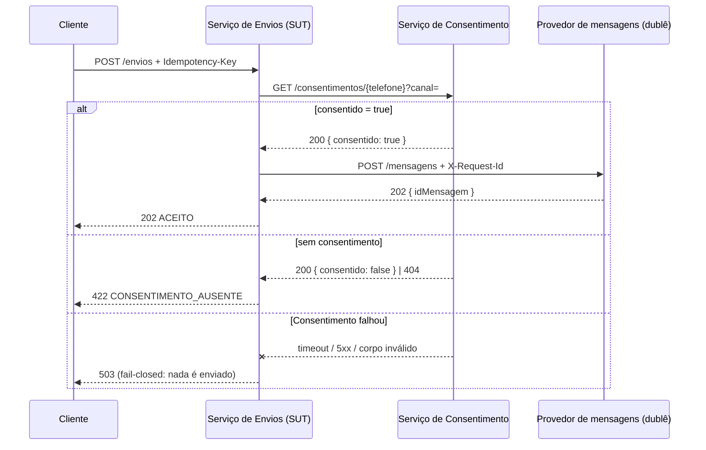

# Testes de integração com apoio de GenAI

Suíte de testes de integração entre três serviços REST, construída a partir de **três tipos de prompt** versionados como artefatos do projeto. O foco é registrar o que cada tipo de prompt gerou, o que precisou ser ajustado e se os testes resultantes realmente pegam defeitos.

Atividade da Unidade III (testes com GenAI) — AKCIT.

## Cenário de integração

Envio de mensagens proativas (WhatsApp/RCS) com checagem de consentimento LGPD:



Envios e Consentimento sobem **de verdade** em portas efêmeras; só o provedor externo é um dublê programável (fila de respostas, atrasos, conexão derrubada) que registra cada chamada recebida. As regras de negócio R1–R5 estão em [`prompts/00-contexto-comum.md`](prompts/00-contexto-comum.md).

## Os prompts

| Tipo de prompt | Arquivo | Versões | Testes |
| --- | --- | --- | --- |
| Contexto comum (colado em todos) | [`prompts/00-contexto-comum.md`](prompts/00-contexto-comum.md) | — | — |
| 1. Geração de cenários de integração | [`prompts/01-cenarios-integracao.md`](prompts/01-cenarios-integracao.md) | v1 → v2 | 9 (CI-01…CI-09) |
| 2. Casos de erro / falhas de dependência | [`prompts/02-casos-de-erro.md`](prompts/02-casos-de-erro.md) | v1 → v2 → v3 | 14 (ER-01…ER-14) |
| 3. Contrato de API dirigido pelo consumidor | [`prompts/03-contrato-api.md`](prompts/03-contrato-api.md) | v1 → v2 | 9 (CT-01…CT-05, provedor e consumidor) |

Cada arquivo traz o texto exato de cada versão, um resumo do que a LLM devolveu e por que o prompt foi ajustado. Modelo usado: Claude Opus 5.5.

## Documentação

| Documento | Conteúdo |
| --- | --- |
| [`docs/casos-gerados.md`](docs/casos-gerados.md) | Catálogo de todos os casos, com a versão do prompt em que cada um surgiu, e os descartados com o motivo |
| [`docs/reflexao.md`](docs/reflexao.md) | Como cada tipo de prompt influenciou qualidade e diversidade, ajustes que mais pesaram, checagem de mutação e limites |
| [`contratos/envios-consentimento.json`](contratos/envios-consentimento.json) | Contrato gerado pelo Prompt 3 e verificado dos dois lados |

## Como rodar

Requer Node.js 18.17+ e nenhuma dependência externa.

```bash
npm test               # 32 testes de integração (~1 s)
npm run test:mutacao   # injeta 6 defeitos no Serviço de Envios e mostra quais testes pegaram cada um
```

Para subir os serviços manualmente: `npm run start:consentimento` (porta 3001) e `npm run start:envios` (porta 3000; o provedor é esperado em `URL_PROVEDOR`, padrão `http://127.0.0.1:3002`).

## Estrutura

```text
src/
  consentimento/servico.js   Serviço de Consentimento
  envios/servico.js          Serviço de Envios (SUT) — regras R1–R5 no cabeçalho
  http.js, validacao.js      utilitários
test/
  apoio/ambiente.js          sobe o ambiente e o provedor falso
  integracao/
    cenarios.test.js         Prompt 1
    erros.test.js            Prompt 2
    contrato.test.js         Prompt 3
contratos/                   contratos consumidor → provedor
prompts/                     prompts versionados (v1, v2, v3)
docs/                        catálogo de casos e reflexão
scripts/mutacao.sh           checagem de mutação
```
